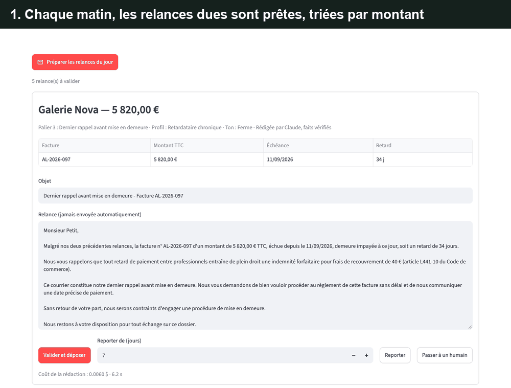

# Agent relances

> Projet 3 d'une suite d'agents pour PME : [agent-factures](https://github.com/micouaidan55/agent-factures) (projet 1) vérifie les factures, [agent-emails](https://github.com/micouaidan55/agent-emails) (projet 2) trie la boîte de réception, agent-relances relance les impayés. Vue d'ensemble de la suite : [agent-pme-suite](https://github.com/micouaidan55/agent-pme-suite).

**Un agent IA qui relance les clients impayés d'une PME au bon moment, sur le bon ton, sans jamais se tromper de montant, sous votre contrôle.**

Dans une PME, relancer les impayés est une corvée qu'on repousse : on oublie une facture, on relance trop tard, on écrit le même mail sec au meilleur client et au retardataire chronique. Cet agent prépare chaque matin les relances dues, adaptées au client et à l'historique, et un humain les valide en quelques secondes. Rien n'est jamais envoyé automatiquement.



*En 30 secondes : les relances du jour, rédigées par Claude sur le ton voulu (ferme avec la mention des 40 € pour un professionnel au dernier palier, léger pour un bon payeur). Une remise ajoutée à la main est refusée par le code. La relance validée est déposée, jamais envoyée. Puis l'historique par client et le tableau de bord.*

C'est le troisième projet d'une suite d'agents pour PME : [agent-factures](https://github.com/micouaidan55/agent-factures) lit et vérifie les factures, [agent-emails](https://github.com/micouaidan55/agent-emails) trie la boîte de réception, et agent-relances suit l'argent jusqu'à l'encaissement.

## Ce que fait l'agent

1. **Lit les factures émises impayées** dans la base d'agent-factures, en lecture seule.
2. **Décide qui relancer, quand et comment** : trois paliers (rappel courtois à J+3, relance ferme à J+15, dernier rappel avant mise en demeure à J+30), regroupement des factures d'un même client, pas plus d'une relance par semaine, puis passage à un humain.
3. **Adapte le ton** au palier et au profil du client, calculé sur son historique de paiement : bon payeur, occasionnel, retardataire chronique.
4. **Fait rédiger la relance par Claude**, puis **vérifie chaque fait par le code** : numéros, montants, échéances, total, mention légale des 40 € pour un professionnel au dernier palier. Un montant faux ou inventé est refusé ; après deux échecs, un modèle de texte de secours prend le relais.
5. **Attend votre validation** : vous relisez, modifiez, validez (le brouillon `.eml` est déposé), reportez ou passez la main à un humain.

## Évaluation

30 scénarios générés couvrent chaque combinaison palier × profil, les particuliers (sans mention des 40 €), les regroupements de 2 et 3 factures, le délai minimal, les fiches manquantes, le passage à un humain et une fiche client qui tente de donner des ordres au modèle.

On mesure : l'exactitude des règles, les faits exacts selon le vérificateur (dès le premier essai et après vérification), le **ton reconnu à l'aveugle** par un juge qui ne connaît ni le palier ni le profil, la note du juge (l'adéquation du ton est mesurée par le ton deviné à l'aveugle), le recours au modèle de secours et le coût par relance.

### Résultats mesurés

Configuration retenue : Claude Sonnet 5 rédige, le code décide et vérifie.

| Métrique | Résultat | Objectif |
|---|---|---|
| Règles (relance, palier, regroupement, mention légale) | 100 % (30/30 scénarios) | 100 % |
| Faits exacts selon le vérificateur | 100 % | 100 % |
| Faits exacts dès le premier essai | 100 % | — |
| Recours au modèle de secours | 0 % | ≤ 5 % |
| Ton reconnu à l'aveugle | 100 % (25/25 relances) | ≥ 85 % |
| Note moyenne du juge | 4,63 / 5 | ≥ 4 |
| Coût moyen par relance | 0,0055 $ | ≤ 0,02 $ |
| Temps moyen par relance | 4,4 s | — |

Le juge lit chaque relance sans connaître ni le palier ni le profil du client : il retrouve le ton voulu dans les 25 cas. La personnalisation n'est donc pas décorative, elle se perçoit à la lecture.

### Expérience : Sonnet ou Haiku pour rédiger ?

| | Sonnet 5 | Haiku 4.5 |
|---|---|---|
| Règles | 100 % | 100 % |
| Faits exacts (après vérification) | 100 % | 100 % |
| Faits exacts dès le premier essai | 100 % | 96 % |
| Ton reconnu à l'aveugle | 100 % | 84 % |
| Note du juge | 4,63 / 5 | 4,53 / 5 |
| Coût moyen par relance | 0,0055 $ | 0,0020 $ |

Haiku coûte presque trois fois moins cher et, grâce à la vérification par le code, ne laisse passer aucun fait faux. Mais il manque l'objectif de ton (84 % contre 85 % visés) : il écrit trop ferme dans 4 relances qui devaient rester neutres ou légères, ce qui est précisément l'erreur à éviter avec un bon client. À moins d'un centime la relance, Sonnet reste le choix par défaut ; le modèle se change d'un paramètre.

Détail par relance : `evals/results/`. Pour reproduire (payant, plafonné, environ 0,20 $ par run) : `uv run python -m evals.run --max-cost 1` ; variante : `--model claude-haiku-4-5`.

## Démarrage rapide

```bash
git clone https://github.com/micouaidan55/agent-relances.git && cd agent-relances
cp .env.example .env        # puis renseigner ANTHROPIC_API_KEY (facultatif : sans clé, le modèle de secours rédige)
uv sync
uv run python -m demo.seed  # base de démonstration ; TODAY=2026-10-15 est déjà dans .env.example ; à vider pour de vraies factures
uv run streamlit run app/main.py
```

La démonstration montre les trois paliers, un regroupement, un particulier, une fiche manquante, un passage à un humain et une facture encaissée après relance. Avec une clé d'API, préparer les relances du jour coûte environ un demi-centime par relance (mesuré : 0,0055 $ avec Sonnet).

Pour relancer les vraies factures d'agent-factures, pointez `AGENT_FACTURES_DB` vers sa base (par exemple `../agent-factures/data/factures.db`) et videz `TODAY`.

## Architecture

```
base agent-factures (lecture seule) ─► factures impayées + historique de paiement
fiches clients ─► profil ─► paliers, regroupement, délai minimal, ton cible, mention légale   (code)
                                          │
                              rédaction par Claude ─► vérification des faits ─► secours si échec
                                          │
                     validation humaine : déposer (.eml) · modifier · reporter · passer à un humain
```

| Module | Rôle |
|---|---|
| `agent_relances.rules` | Règles de recouvrement : profil, paliers, regroupement, ton, mention légale (fonctions pures) |
| `agent_relances.drafting` | Rédaction par le modèle, vérification des faits, modèle de secours |
| `agent_relances.sources` | Lecture seule d'agent-factures |
| `agent_relances.storage` | SQLite : fiches clients, historique des relances, journal |
| `app/` | Interface Streamlit : relances du jour, clients, tableau de bord, journal |
| `evals/` | 30 scénarios, métriques, juge à l'aveugle |

### Le code décide, le modèle rédige, le code vérifie

Quand relancer, à quel palier et sur quel ton relève de règles métier : elles sont écrites en code, testées et identiques pour chaque client. Le modèle ne fait que ce qu'il fait mieux qu'un modèle de texte : écrire une relance naturelle, adaptée au client. Et comme un montant faux dans une relance, c'est un client fâché, le code relit chaque brouillon avant de vous le montrer : il refuse tout montant ou toute date qui ne figure pas dans les factures.

### Garde-fous

- **Lecture seule** sur la base d'agent-factures, qui reste la seule source de vérité sur les paiements.
- **Aucun envoi automatique** : la validation dépose un brouillon `.eml`.
- **Vérification des faits** avant affichage et à nouveau au dépôt, y compris après une modification humaine.
- **Pas de mise en demeure automatique** : après le dernier rappel, la facture passe à un humain.
- **Modèle de secours** : une panne d'API ou une sortie fausse ne bloque jamais une relance.

## Réponses, échéanciers et contentieux

Relancer ne suffit pas : le client répond (« je paie vendredi », « pouvez-vous étaler ? », « cette facture est fausse »). La V2 lit ces réponses, propose l'action qui convient et suit les échéanciers jusqu'au contentieux. **Un humain confirme chaque action ; rien n'est jamais envoyé.**

### Cycle de vie d'une réponse

1. Le client répond à une relance ; la réponse arrive dans la boîte `AGENT_RELANCES_INBOX` (les `.eml` triés par agent-emails).
2. Elle est rattachée au client par la référence de l'objet (`[Réf. R-00042]`) ou, à défaut, par l'adresse de l'expéditeur.
3. Claude Haiku la lit et en tire une intention : paiement annoncé, date promise, demande d'échéancier, accord, contestation, autre.
4. Le code propose l'action, après un contrôle de fraude propre à agent-relances (`reply_is_suspicious`) :
   - paiement annoncé : report de 7 jours ;
   - date promise : report jusqu'à cette date + 3 jours (date vague ou passée : traitement humain, jamais de date inventée) ;
   - demande d'échéancier : proposition d'échéancier ;
   - accord : activation de l'échéancier proposé (sans proposition en attente, rien n'est activé) ;
   - contestation : suspension des relances et passage à un humain ;
   - autre ou réponse suspecte : humain, aucune action.
5. L'humain confirme. Une action porte sur toutes les factures impayées du client ; si tout est soldé, la réponse est seulement archivée « sans objet ».

### La règle d'échéancier

- 4 mensualités au maximum, au moins 100 € chacune ;
- sous 200 € au total, un échéancier en 2 fois reste possible ;
- montants égaux arrondis au centime, la dernière mensualité absorbe l'écart ;
- l'échéancier couvre toutes les factures impayées du client, un seul à la fois par client.

Le modèle ne calcule jamais rien : la règle est calculée et vérifiée par le code, revérifiée avant tout enregistrement ou dépôt, et un nombre de mensualités hors règle (5, ou 3 pour 250 €) est refusé avec sa raison. Un test exhaustif couvre 1,37 million de cas.

### Suivi d'un échéancier

*Proposé*, puis *en cours* à l'accord du client (première échéance 30 jours après l'accord, puis chaque mois à la même date), puis *soldé* ou *rompu* ; l'humain peut l'*annuler*. Une mensualité manquée déclenche les relances J+3, J+15 et J+30 depuis son échéance, chacune validée par un humain. Sans paiement, un contentieux est proposé 7 jours après la 3e relance validée.

### Dossier pour l'avocat

Le contentieux produit un dossier : un PDF de synthèse, les copies des factures, l'historique des relances et des réponses, et un brouillon `.eml` à l'attention de l'avocat (`AVOCAT_EMAIL`). Le dossier est déposé dans `AGENT_RELANCES_DOSSIERS` ; il n'est jamais envoyé.

### La boucle avec agent-emails

Les relances déposées portent `[Réf. R-00042]` (échéanciers : `[Réf. E-00007]`). Quand le client répond, [agent-emails](https://github.com/micouaidan55/agent-emails) reconnaît cette référence et laisse la réponse à agent-relances (statut « À ignorer », aucun appel au modèle). Une fausse référence ne contourne rien : agent-relances refait son propre contrôle de fraude et un humain confirme toute action.

### Nouvelles variables d'environnement

| Variable | Rôle |
|---|---|
| `AGENT_RELANCES_INBOX` | Dossier des réponses reçues (`.eml`), par exemple `../agent-emails/inbox` |
| `AVOCAT_EMAIL` | Adresse de l'avocat, destinataire du brouillon `.eml` du dossier |
| `AGENT_RELANCES_DOSSIERS` | Dossier où sont déposés les dossiers de contentieux |
| `COMPANY_DOMAIN` | Domaine de l'entreprise, utilisé pour repérer les réponses suspectes (facultatif) |

### Boîte de démonstration

`uv run python -m demo.seed` dépose aussi six réponses de clients dans `data/demo_inbox` : pointez `AGENT_RELANCES_INBOX=data/demo_inbox` pour parcourir tout le cycle sans clé ni vraie boîte mail.

### Évaluation des réponses

<!-- RESULTATS-REPONSES -->
Résultats de l'évaluation des réponses : à venir (`uv run python -m evals.replies.run --max-cost 1`).

## Grille du juge

Le juge (Claude Sonnet) lit chaque relance sans connaître le contexte, devine son ton (léger, neutre, ferme) et la note de 1 à 5 sur la clarté, la politesse et la précision de la demande. La grille complète se trouve dans `evals/judge.py`.

## Tests

```bash
uv run pytest
```

Les tests utilisent un faux client et ne consomment aucun crédit d'API.

## Limites connues et feuille de route

- Les réponses des clients sont lues depuis la V2 (voir « Réponses, échéanciers et contentieux ») ; la mesure sur de vraies réponses reste à faire.
- Pas de priorisation de trésorerie ni de score de risque, pas de pénalités de retard calculées.
- Scénarios synthétiques : la mesure sur de vraies relances reste à faire.
